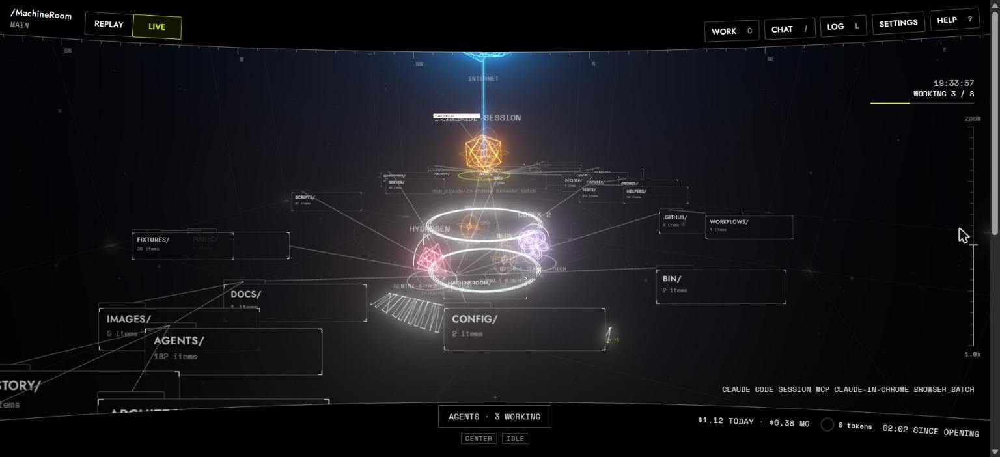
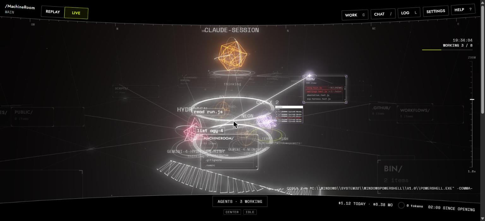

# MachineRoom

Watch coding agents work on your project as a live 3D machine room in the browser.



The room above is a real session: Claude Code leads on top, Gemini 4 Neon (Antigravity) and GPT-6.2 Sol (Codex) lead as sub orchestrators, and Gemini 4 Hydrogen, GPT-6.1 Terra and DeepSeek V4.1 Flash write the code.

## What you see

- Agents: each agent is a wireframe shape in its own colour. Its harness and name float over it, and its model and effort sit under it, with what it is doing right now beneath.
- A team: the orchestrator sits on top. Each sub orchestrator floats over its own arc of the hub ring, with its coders inside it.
- Your project: folder cards orbit the hub slowly, far apart, each drifting on its own. A slider in Settings sets how far apart they sit.
- Work as it happens: a working agent sends a tunnel and a star to the file it touches. A new file or folder is drawn by a light trail as the star lands, and its label pops up when it arrives.
- State at a glance: rings around each agent turn white while it thinks, yellow while a command runs, green when it finishes and red when it fails.
- Sound: stereo machine sounds follow the room: a low tone for each star, a soft beep for each touch, a whir while an agent thinks. Play music, and the room pulses and dances to the beat.



## Quick start

Requires Node 24 or newer, git, a browser with WebGL, and Claude Code, Codex, Antigravity, OpenCode or Hermes signed in, or a Direct API key.

```
npm install
npm run build
npm link
```

Then from any project folder:

```
machineroom [FOLDER]
```

Without `npm link`, run this in the MachineRoom folder:

```
npm run serve -- up --root FOLDER --open
```

To try the demo tour without another project, start the room here and open `/?replay&fixture=scenario-i&tour`.

MachineRoom keeps its records, logs and costs on this computer; the agents still send your code to their model providers.

## What you can do

- Watch your own Claude Code, Antigravity, OpenCode and Hermes sessions live on the project.
- Build a team in Agents: any harness can be an orchestrator, a sub orchestrator or a coder.
- Ask the orchestrator for work and let it plan, start and review lane runs.
- Run tasks on lanes, each in its own git worktree.
- Open any lane's conversation from Agents or its Inspector, with Stop while it runs.
- Review a lane's branch diff and merge it when its checks pass.
- Replay a recorded run or the rolling live session.
- Track this month's cost per lane.


## Docs

- [User guide](docs/GUIDE.md): flags, settings, the orchestrator, lanes, replay, keys and common problems.
- [Contributing](CONTRIBUTING.md): setup for development, tests and the review loop.
- [Architecture](docs/agents/ARCHITECTURE.md): the room, the bridge and the data flow.

## Made with

MachineRoom is built by coding agents under the owner's direction, and the room shows them doing it:

- [Claude Code](https://claude.com/claude-code) as the orchestrator.
- [Antigravity](https://antigravity.google) with Gemini 4 Neon and Hydrogen as a sub orchestrator and a coder.
- [Codex](https://openai.com/codex) with GPT-6.2 Sol and GPT-6.1 Terra as a sub orchestrator, a coder and a reviewer.
- The native DeepSeek lane (`scripts/mr-agent.mjs`) over OpenRouter.
- [OpenCode](https://opencode.ai) and [Hermes Agent](https://github.com/NousResearch/hermes-agent) in earlier rounds.

## Licence

MachineRoom is released under the MIT licence. See [LICENSE](LICENSE).

## History

MachineRoom grew out of [Paperclip](https://github.com/paperclipai/paperclip) as an independent project and now runs its own lane runner and session readers.
