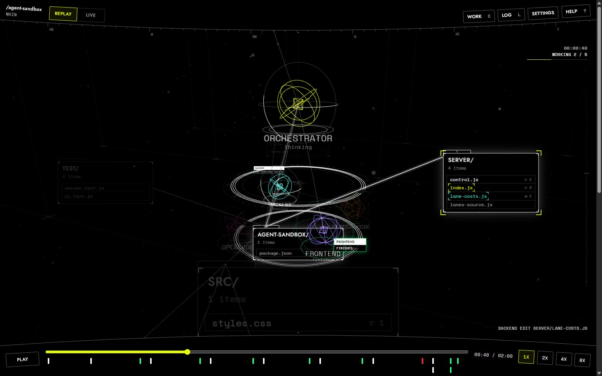
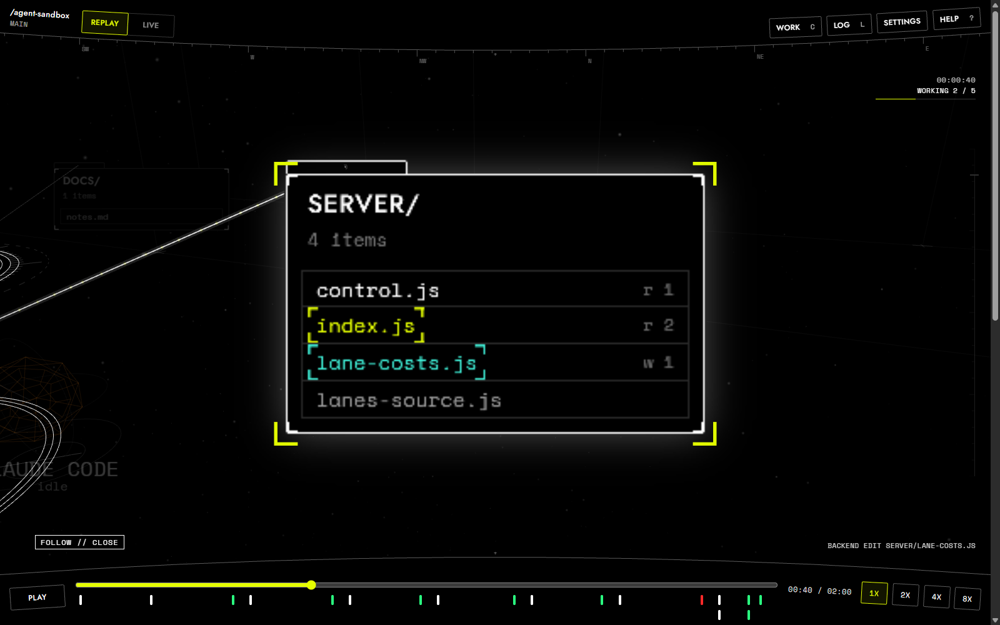
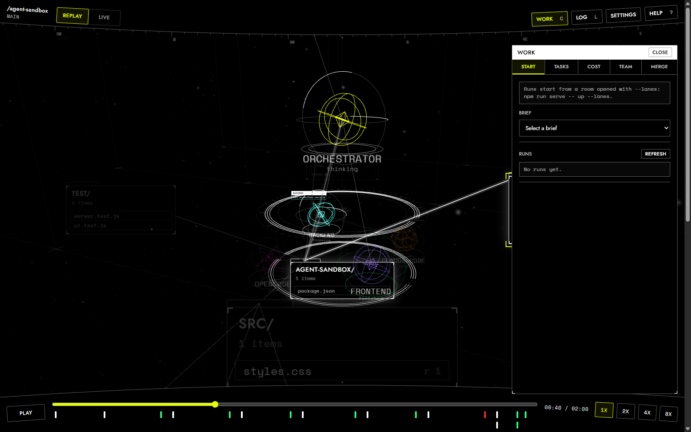

# MachineRoom

MachineRoom shows coding agents working on one project as a 3D machine room in your browser.



## What you see

- Each agent is a wireframe shape in its own colour on the hub ring, with the orchestrator above the centre.
- Always-on rings around each agent tell its state: red when failed, white while thinking, yellow while running a command, and green when finished.
- Folder cards sit in a ring around the hub, joined by faint strings to the root card under it, listing their files.
- A working agent sends a grey tunnel and a star in its colour to the folder card and file it touches, or a blue beam to the INTERNET sphere when it uses the web.
- One box beside each working agent holds its task, its current command and its last five console lines.



Follow mode close up on the card an agent is touching.

## Quick start

Requires Node 24 or newer, git, a browser with WebGL, and Claude Code, OpenCode, Codex or AGY signed in, or a Direct API key.

```
npm install
npm run build
npm link
```

Then from any project folder:

```
machineroom [FOLDER]
```

Without `npm link`, run this in the MachineRoom folder:

```
npm run serve -- up --root FOLDER --open
```

To try the demo tour without another project, start the room here and open `/?replay&fixture=scenario-i&tour`.

MachineRoom keeps its records, logs and costs on this computer; the agents still send your code to their model providers.

## What you can do

- Watch your own Claude Code and OpenCode sessions live on the project.
- Ask the orchestrator for work and let it plan, start and review lane runs.
- Run tasks on lanes, each in its own git worktree.
- Open any lane's conversation from Agents or its Inspector, with Stop while it runs.
- Review a lane's branch diff and merge it when its checks pass.
- Replay a recorded run or the rolling live session.
- Track this month's cost per lane.



The control drawer open on Dispatch.

## Docs

- [User guide](docs/GUIDE.md): flags, settings, the orchestrator, lanes, replay, keys and common problems.
- [Contributing](CONTRIBUTING.md): setup for development, tests and the review loop.
- [Architecture](docs/agents/ARCHITECTURE.md): the room, the bridge and the data flow.

## Made with

MachineRoom is built by coding agents under the owner's direction:

- [Claude Code](https://claude.com/claude-code) as the orchestrator and a lane.
- [AGY](https://antigravity.google) (Google Antigravity) as a coding lane.
- [Codex](https://openai.com/codex) as a coding and review lane.
- [OpenCode](https://opencode.ai) as a coding lane.
- The native DeepSeek lane (`scripts/mr-agent.mjs`) over OpenRouter.
- [Hermes Agent](https://github.com/NousResearch/hermes-agent) as an earlier orchestrator.

## Licence

MachineRoom is released under the MIT licence. See [LICENSE](LICENSE).

## History

MachineRoom grew out of [Paperclip](https://github.com/paperclipai/paperclip) as an independent project and now runs its own lane runner and session readers.
