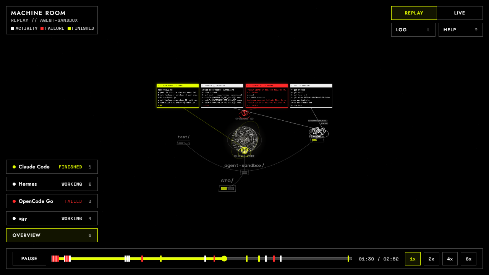
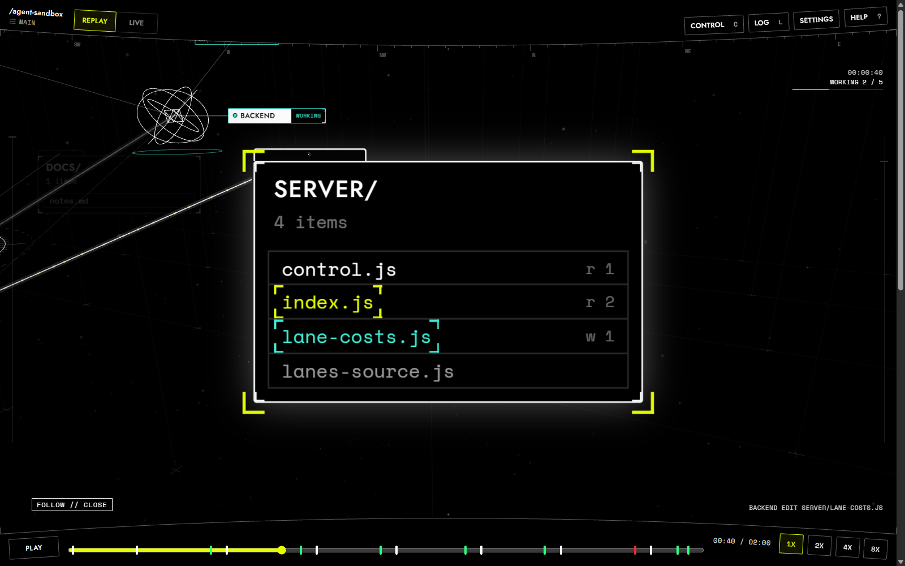
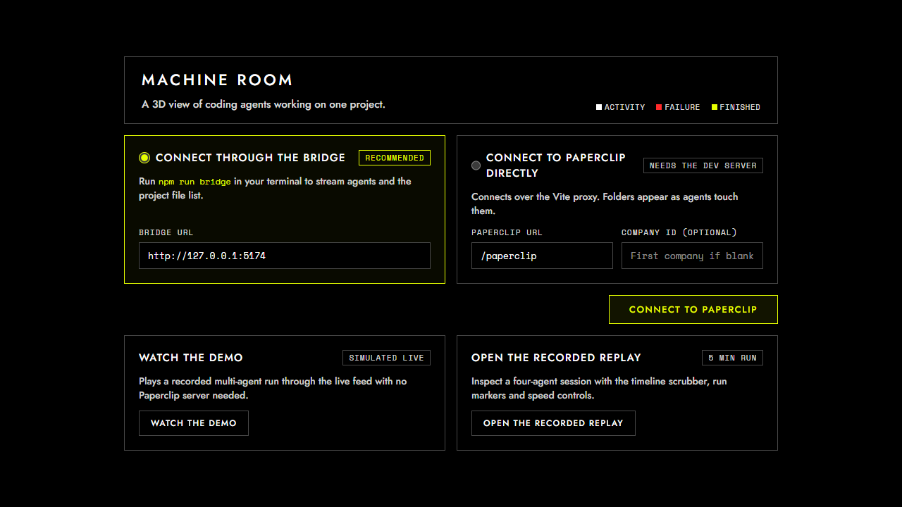
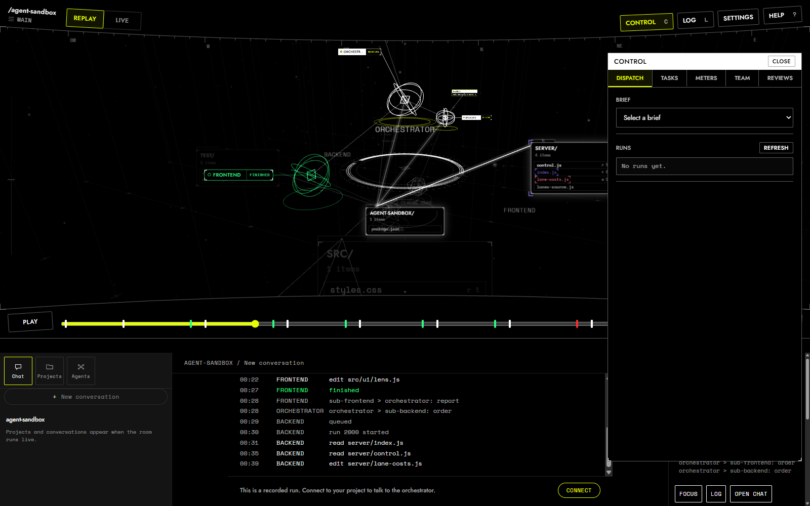
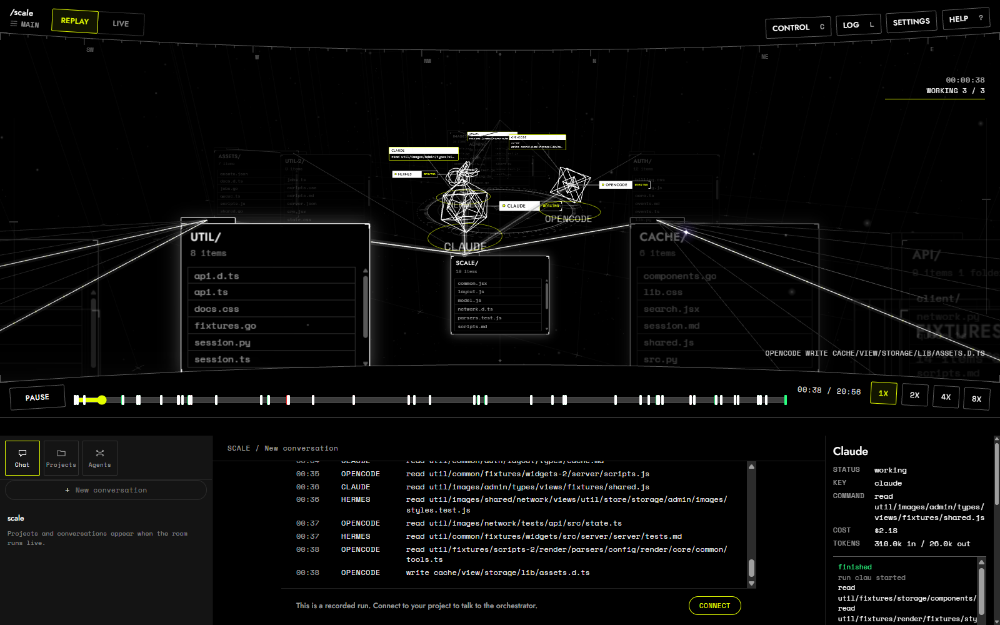

# Machine Room

A browser viewer that shows coding agents working on one project as a 3D machine room. The agents park on a hub and the project folders sit on a sphere around them. It replays recorded runs, shows lane runs, and can follow a local Paperclip instance live.

MachineRoom grew out of [Paperclip](https://github.com/paperclipai/paperclip): it began as a viewer for a Paperclip instance, and its idea of a company of agents with tasks, budgets and approvals comes from there. The room now runs its agents through its own lane runner (`npm run run-lane`) and can still follow a Paperclip instance when one runs. MachineRoom is an independent project and is not made by or endorsed by Paperclip.

## Screenshots



The overview, with the hub, the parked agents and the folder sphere.



Follow mode close up on the card an agent is touching.



The connect screen.



The control drawer open on Dispatch.



A seeded room at 40000 files.

## What you see

- The hub: a flat ring in the middle. Each agent parks at its own slot there, between runs and while it works. The orchestrator floats above the middle of the ring.
- Agent shapes: each agent is its own wireframe shape. A working agent shows it by its status ring, its chip and a slow pulse of its shape.
- Subagents: a child reported by an OpenCode or Hermes run appears beside its parent as a smaller shape with its own chip, joined to the parent by a short line. The harness reports it only when it ends, so it stays at full strength for 6 seconds and then fades over 1.5 seconds.
- Terminal chips: a chip beside each agent, joined by a thin line. It shows the name and a status ring, and opens to show the log.
- Agent callouts: a thin line from an agent to a block with its name, the task its run works on and the command it runs now. The border is yellow while it works, red on a failure and green with `FINISHED` for 5 seconds after a good run.
- Folder sphere: flat cards, always facing the camera. Top-level folders sit on a packed first shell whose radius grows with their count, and the root sits below the hub. A closed folder stacks up to four of its children behind it, and the rest show as faint backs. When the working path opens a folder, its children step outward 650 units for that level and fan beside each other. Straight lines join each top-level folder and the root to the hub centre, and every deeper folder to its parent.
- The tree: every folder down to depth 2 is always drawn, up to 300 cards. Folders below that depth appear, with a short fade, only while they are on an agent's path. A folder that holds a file being touched lists up to 10 items.
- The strip: while an agent works, a straight line runs from it to the row of the file it touches, faint white with yellow stripes. Small yellow points run along it every 90 ms, and a burst of five leaves at each tool call. Four yellow corner brackets sit around that card.
- Strands: each line between folders carries small white points. When the folder is on a working agent's path, its points turn yellow and travel along the line, then fade back over 1.5 seconds.
- Follow mode: `F` cycles wide, close up and off. Wide shows the touched card and its parent, and close up shows the card alone. The camera holds each card at least 4 seconds and eases over 1.2 seconds. A click in the room ends it, and so do `0` and `1` to `9`.
- Each colour has one meaning:
  - White is activity. A read or write flashes the file row and its card white.
  - Yellow is active. The folder and the file an agent works on right now carry a dashed yellow outline, and the strip to the file carries yellow stripes.
  - Red is failure. A failed tool call, run or test flashes red and leaves the file red until it is written again. The strip's stripes and points turn red when the run fails.
  - Green is finished work. A run that ends well turns the agent, its chip and every file it wrote in that run green. The strip's stripes and points stay green for 5 seconds.
- While any agent works, cards off the working agents' paths dim to 0.25 with their lines, and the cards on a path to a touched file glow with a soft light on the border.
- Settings: the Settings button at the top right opens a panel. Folder depth is a slider from 1 to 3, 2 by default, for how many folder levels are always drawn. Five screen effects have an on switch and a strength: fish eye, chromatic aberration, vignette, grain and fine dust. Fish eye, chromatic aberration and grain start off. Vignette and fine dust start on at low strength. The fine dust is motes in the 3D space around the room, not noise on the screen. The choices are saved in this browser with the connection.
- Fine dust: 1400 small points across the space around the room, from 400 to 9000 units out. They drift slowly, and they hold still under reduced motion.
- Cost board: a flat panel at the bottom right, above the transport bar, 280 pixels wide. It shows the spend against the budget, a row per agent with cost, tokens and a share bar, and the provider quota windows. It is hidden under 900 pixels wide.
- Health chip: under the Replay and Live switch, and only when something is wrong. It names a bridge that does not answer, a Paperclip that is not connected, routes that changed or a route check that did not run.
- Control drawer on `C`: Dispatch, Tasks, Approvals, Meters, Plan, Agents and Reviews. The drawer section below describes each tab.

There is no randomness. The same recording always draws the same room.

## Run it

You need Node 24 or newer. Build the viewer once, then serve it with the bridge on one port:

```
npm install
npm run build
npm run serve -- up --lanes
```

`--lanes` (or `MACHINEROOM_LANES=1`) shows lane runs live. Start a lane in another terminal (`npm run run-lane -- opencode <brief>`, see Working with lanes): the bridge sees its log appear in `%TEMP%\machineroom-runs`, the lane turns working, its reads and writes land on the project's cards as the log grows, and the run turns green or red when `run-lane` records how it ended. Each lane in `docs/agents/lanes.json` with a `cli` block is an agent, and a retired lane is left out. AGY is a lane too (`npm run run-lane -- agy <brief>`).

The project folder defaults to the folder you start in; `--root <folder>` or `PROJECT_ROOT` names another. The bridge listens on port 5174 by default; `--port <n>` or `PORT` changes it.

For development, `npm run dev` serves the viewer on port 5173 and `npm run bridge` runs the bridge on port 5174 without a build.

### With Paperclip

MachineRoom grew out of Paperclip and can still follow an instance on this machine, beside the lanes or alone. It never starts Paperclip. Start it yourself, in its own terminal, with `paperclipai run`, then add `--company <id>` to `up`: the company to follow, from Paperclip's company list (`PAPERCLIP_COMPANY_ID` does the same). `--paperclip <url>` or `PAPERCLIP_URL` names a Paperclip other than `http://127.0.0.1:3100`.

`up` runs the checks, prints one `ok` or `FAIL` line for each, then serves the room and prints the address to open:

- Paperclip answers, and its version.
- Its spec lists every route the bridge uses.
- The company is in Paperclip's list.
- The project folder exists.
- Automatic database backups are on, and the newest is under a day old.

Without Paperclip the Paperclip checks print FAIL. A failed check does not close the room. A part whose routes changed stays off, and its panel says so.

`npm run serve -- doctor` runs those checks alone, starts nothing, and exits 1 when one fails. `doctor` takes `--paperclip`, `--company` and `--root`. `serve` and `up` also take `--port <n>`. The environment variables `PAPERCLIP_URL`, `PAPERCLIP_COMPANY_ID` and `PROJECT_ROOT` do the same; `PORT` sets the port for `serve` and `up`.

### Replays

The replay and the simulated feed need neither Paperclip nor a lane.

The first visit shows a connect screen, and the replay is one of its choices. An address skips the screen:

- `/?replay` plays the recorded run.
- `/?replay&scale=200000` plays a seeded room of 200000 files in a tenth as many folders, with three agents touching files at random. The number is a whole number from 1000 to 500000.
- `&fps` adds a line in the HUD's top left panel with the median and p95 frame time over the last 120 frames.
- `/?live&simulate` plays the same recording through the live path. The badge reads `Demo`. Add `&speed=3` to play faster; the speed is clamped from 0.25 to 64.
- `/?recording=<name>` opens a recording of a lane run.
- `/?live&bridge=http://127.0.0.1:5174` follows a bridge: its lane runs with `--lanes`, and Paperclip when one runs.
- `/?connect` shows the connect screen again.

Drag to turn the view. Scroll to zoom.

## Big repositories

The room was measured on seeded trees of 40000 and 200000 files.

- `GET /api/tree` holds about 0.6 MB in the folder shape at 40000 files, and 115 KB gzipped. At 200000 files it holds about 3.1 MB, and 570 KB gzipped.
- The answer carries a version. A page's first `tree` event holds only the files added since the list it read, and each later event only the files that page has not had.
- Shell commands and Hermes reads look names up from an index, so they cost the same at any repository size.
- The sphere layout compares pairs only on the top-level shell, so stacks and fans take one pass. The room runs the layout when a card appears, leaves or changes size, and a warm start keeps every card whose role did not change.
- The overview fits the hub, the root and the always-present cards. At 40000 files its distance is about 4200 units (largest about 4700), so the cards are small in the overview. Follow mode is the way to read the card an agent touches.

Try it with the dev server:

```
npm run dev
```

Open `/?replay&scale=200000&fps`. The frame line sits in the top left panel. `npm run scale-probe` times each stage of the room on a seeded tree in memory and prints the covered top cards, the tallest layout and the overview distance; `--files` and `--folders` change its size.

## The control drawer

The drawer needs a control client. It is there in replay, the demo and a live room through a bridge; it is not there when the page talks to Paperclip directly through the Vite proxy. With a control client, the drawer has up to seven tabs.

- Dispatch: pick an open brief to see its prompt and route. The Route row suggests a lane and model, with a Use button when the policy names one. You can also write a task for an agent, and the Runs list shows running and recent lane runs.
- Tasks: open and finished tasks. A task with a live Paperclip run reads `running AGENT` or `queued AGENT`. Open one to read its thread and post a comment.
- Approvals: pending requests with Approve, Request changes and Reject, an optional note, and a list of decided ones.
- Meters: company and agent budgets, spend, provider quotas, and the age of the newest Paperclip backup. Back up now sits behind a confirm card.
- Plan: write a goal and ask the planner behind a confirm card. Each brief shows its size, files, tests and route. Tick the ones to add to `docs/agents/TASKS.md` behind a second confirm card, then open one in Dispatch with `Dispatch <id>`.
- Agents: hire an agent, or edit its name, role, model, limits, budget and instructions. The harness is fixed once the agent is hired.
- Reviews: each lane's branch, commits ahead, files and last run. Click a row for the diff. Merge opens a confirm card with a message and merges the head you read.

## Working with lanes

A lane is one agent with its own worktree and branch, listed in `docs/agents/lanes.json`. There are five OpenCode lanes (`opencode` and `opencode2` to `opencode5`), `agy` works by hand and has no command line, and `hermes` is retired, so `npm run run-lane` refuses it. The drawer can start a local lane run on an open brief and show the result.

- Start a lane run. Press `C`, open Dispatch, pick a brief, then Run now. The confirm card names the lane, model and brief and says it spends money. Confirm starts the lane in its own worktree. The Runs list shows its last lines and its record.
- Start one from a terminal. `npm run run-lane -- opencode <brief>` starts a lane on the open brief you name. `--dry-run` prints the command, `--list` shows the last 10 runs, and `--stats` shows runs, minutes and cost per lane and model.
- Record a hand run. `npm run hand-run -- <lane> <brief> --minutes 40` writes the run of a lane started by hand; a lane with a command line, AGY included, runs through `run-lane` instead. `npm run outcome -- <branch> merged --grade A-` records how a lane run ended.
- See it in the room. A lane run is not a Paperclip run, so the live room does not draw it. When it ends, it writes a recording under `public/recordings/` and prints `room: /?recording=<name>`; open that address to replay it in the room.
- Try a lane's build beside the stable room. `npm run candidate -- <lane>` builds that worktree and serves it on port 5175, with its own bridge. Leave the stable room running and compare the two. It refuses a lane with no worktree, a worktree with uncommitted changes, and a port in use. See `docs/agents/CANDIDATE.md`.
- Review and merge. Press `C`, open Reviews. Each lane shows its branch, commits ahead, files and last run; click it for the diff. Merge is offered on a lane with commits ahead and no uncommitted changes, after a confirm card with a one-line message. The bridge merges one lane at a time, needs the main checkout on main with no uncommitted changes, a clean lane and the lane's exact head, stops on a conflict and leaves main as it was. It never pushes.

## Use it on another project

The room can show a lane run on a folder outside this repository. Serve the room on that folder and turn the lane source on:

```
npm run serve -- up --lanes --root C:\GitHub\Other
```

Then start a lane on the same folder, with the task text or a UTF-8 file that holds it:

```
npm run run-lane -- opencode --project C:\GitHub\Other --task "Fix the failing test."
npm run run-lane -- opencode --project C:\GitHub\Other --task-file task.md
```

The runner refuses this checkout, a lane worktree and a git folder with uncommitted changes. Pass `--allow-dirty` to allow a dirty folder. It runs the harness in that folder, makes no branch, reads no brief and writes no recording. The room shows the run live, with its reads and writes on that folder's cards.

With `--lanes`, the Dispatch panel can start the same kind of run on the room's own folder: pick a lane, write the task, and turn on `Allow uncommitted changes` when the folder has them.

A lane's `cli.model` can name a `provider/model` from any OpenAI-compatible provider in OpenCode's own config. The key stays in that config or an environment variable, never in `docs/agents/lanes.json` or this repository. MachineRoom does not set up a provider and does not read the key.

## What it never does

- It never starts or stops Paperclip. Start it yourself with `paperclipai run`.
- It never pushes to a remote.
- It merges a lane only after the Reviews confirm card. The bridge also refuses a merge without an explicit confirm and the lane's exact head.
- It starts a lane run or asks the planner only after a confirm card that says it spends money. `Start task` is different: it creates a task in Paperclip, which can wake its agent at once, so that path can spend without a card.

## Keys

- `Space` play or pause replay
- `0` overview camera
- `1` to `9` focus agent 1 to 9
- `F` follow the card an agent is touching: wide, close up, off
- `T` show or hide the log of the selected agent, or of every agent
- `Left` and `Right` arrows seek backward or forward 5 seconds
- `[` and `]` decrease or increase replay speed
- `/` open the assistant terminal
- `L` toggle the event log
- `C` toggle the control drawer
- `?` toggle keyboard help

MachineRoom prints and stores no key. The bridge needs no key to run: the assistant route runs OpenCode, which uses the login on this computer, and only the optional decision route reads `OPENROUTER_API_KEY` from the environment (without it that route answers 404). The assistant refuses text that looks like a key. The bridge masks key-shaped text in the log chunks, messages and errors it sends, including a key split across two or more chunks; a held chunk delays frames by at most 1 second. The proxy route has no bridge; the page masks the frames it reads itself, with the same rule and the same 1 second hold.

## Recordings

Every run started with `npm run run-lane`, including Run now in Dispatch, writes a recording under `public/recordings/` when it ends, and prints `room: /?recording=<name>`. If it cannot write one, it prints why. The name is the run's log name. `public/recordings/index.json` lists the last 50, newest first, with lane, briefs, model, start, minutes, exit code, frames and tool calls. `npm run run-recording -- 1` writes a recording from the newest run record again. The folder is not in git.

## Checks

```
npm test
npm run build
npm run doctor
npm run history-audit
npm run pack-check
```

- `npm test` runs vitest in Node with no browser.
- `npm run build` also catches broken imports.
- `npm run doctor` compares a running Paperclip's spec with the routes and fields the bridge uses, and names each missing or changed one.
- `npm run history-audit` scans main, the tags and the tracked files for keys, e-mail addresses, Windows user paths, the profile name and paths into one private folder. A key shows only its first 4 characters and its length. It exits 1 on any finding.
- `npm run pack-check` checks what `npm pack` would hold. It fails on a file the one-port command needs but the pack leaves out, and on `.env`, tests, recordings, `node_modules`, `.git` or a log file in the pack.

The code is described in `docs/agents/ARCHITECTURE.md`.
