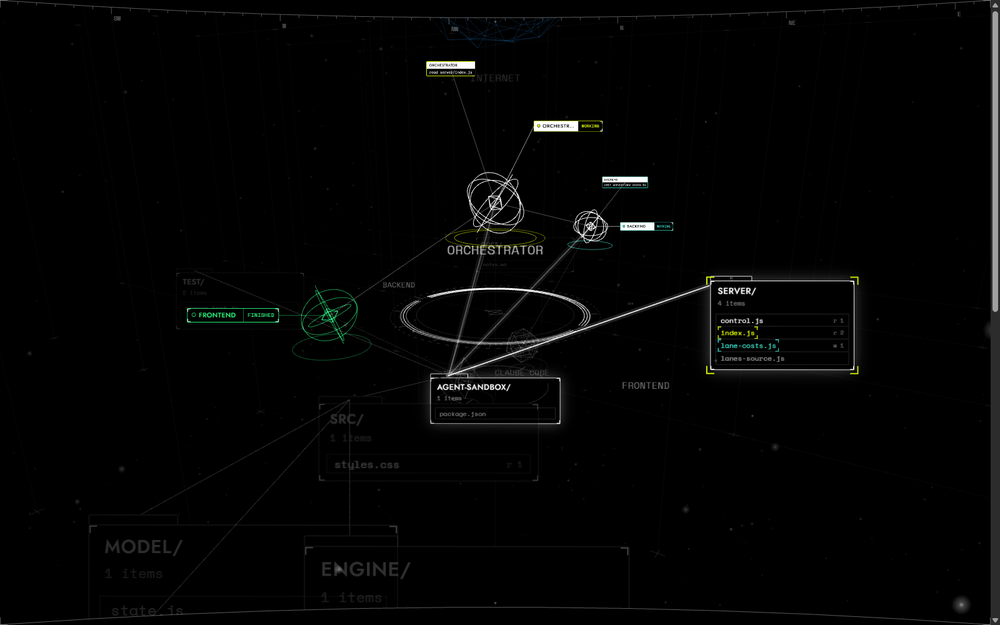

# MachineRoom

MachineRoom shows coding agents working on one project as a 3D machine room in your browser.


## What you see

The room puts each agent on a ring in the middle, as its own wireframe shape. Your project folders sit around it as flat cards, and a working agent sends a grey tunnel to the card of the file it touches. Each agent has its own colour: its stars fly along the tunnels, and camera brackets in that colour mark the folder and file it is touching. White is activity, yellow is active, green is finished work and red is failure.

After a minute without input, the menu and the transport slide away, the lens fills the whole window and the room turns slowly. Any key, click or scroll brings them back.



## What you can do

- Watch your own Claude Code and OpenCode sessions live on the project.
- Ask the orchestrator for work and let it plan, start and follow the runs.
- Run tasks on lanes, each in its own git worktree.
- Open any lane's conversation from its row in Agents or its Inspector, with Stop while it runs.
- Review a lane's branch and merge it when it passes.
- Replay a recorded run.
- See the cost per lane for this month.

## Quick start

You need Node 24 or newer, git, a browser with WebGL, and Claude Code, OpenCode or AGY signed in, or a Direct API key.

### First run

On Windows PowerShell, use `npm.cmd` instead of `npm` when the script policy refuses it, and `npm.cmd link` to link. Leave the execution policy as it is.

Run these in the MachineRoom folder.

```
npm install
npm run build
npm run serve -- doctor
```

- `npm install` installs the packages and prints the summary (`added N packages` or `up to date`), plus npm funding and audit notes.
- `npm run build` writes the built viewer, prints the asset list, `built in` with the time, and an expected Vite chunk-size warning (`Some chunks are larger than 500 kB`).
- `npm run serve -- doctor` checks the folder, project files, git, built viewer, runs folder and lane programs, then prints a Dispatch tip and `All checks passed.` If the folder is not a git repository, it prints `All checks passed, 1 warning.` and still exits 0.

Link the command once:

```
npm link
```

This binds the global `machineroom` command to the current clone folder. Moving or deleting that folder breaks `machineroom` until you run `npm.cmd unlink -g machine-room` (or `npm unlink -g machine-room`) and link again.

Then, from any project folder (`FOLDER` is optional and defaults to the current folder):

```
machineroom [FOLDER]
```

Without `npm link`, run this in the MachineRoom folder (`--root` is optional and defaults to the current folder or `PROJECT_ROOT`):

```
npm run serve -- up --root FOLDER --open
```

Both run the doctor checks, turn on the lane and session sources by default, and start the viewer and bridge on port `5174`. They print the doctor lines, `All checks passed.`, `MachineRoom is running.`, the process id and port, the room address (`machine-room: open http://...`) and a Dispatch tip. Press `Ctrl+C` in the terminal to stop the room.

`machineroom` opens the browser unless you pass `--no-open`. `npm run serve -- up` keeps the browser closed unless you pass `--open`. Passing `--no-open` still prints `machine-room: open http://...` in the terminal.

Common flags for `up`:

```
npm run serve -- up --port 5180 --no-open --no-sessions
npm run serve -- up --help
```

- `--root <folder>`: project folder (`PROJECT_ROOT`), optional.
- `--port <n>`: port to listen on (`PORT`, default `5174`).
- `--no-open`: keep the browser closed (`machineroom` also accepts `--port`, `--no-open`, `--no-sessions` and `--help`).
- `--open`: open the room in the default browser.
- `--no-sessions`: keep the session source off (`up` turns on both the lane and session sources by default).
- `--dist <folder>`: built viewer folder (default `dist` beside `bin`).
- `--help`: show all commands and options (`npm run serve -- --help`).

Without `up`, bare `npm run serve` skips the doctor checks and leaves both sources off unless you pass `--lanes` (`MACHINEROOM_LANES=1`) or `--sessions` (`MACHINEROOM_SESSIONS=1`).

Run `npm run build` again in the MachineRoom folder after you pull a new version.

No project at hand? Run `npm run serve -- up --open` (or `machineroom`) in the MachineRoom folder, then open `/?replay&fixture=scenario-i&tour` on the room's address to take the demo tour.

The room writes run logs, locks and orchestrator state (`orchestrator-<hash>.json` and `orchestrator-<hash>.lock`) inside the runs folder. By default that is `%LOCALAPPDATA%\MachineRoom\runs` on Windows, or `$XDG_STATE_HOME/machineroom/runs` or `~/.local/state/machineroom/runs` elsewhere. Set `MACHINEROOM_RUNS` to change it: in PowerShell `$env:MACHINEROOM_RUNS = "$env:TEMP\machineroom-runs"`, or `MACHINEROOM_RUNS=/path/to/runs` in bash.


Follow mode close up on the card an agent is touching.


The control drawer open on Dispatch.

## Lanes

A new room starts with the orchestrator and no custom lane. While the session source is on (the default for `up`), the room also lists `Claude Code session` and `OpenCode session`. Make a lane in the Agents tab: open the family tree, press Add child on the orchestrator, and fill in the label, harness, model and effort. Each lane runs in its own harness on the owner's account.

Open a lane's conversation from the chat button on its row in Agents or Open conversation in its Inspector. It loads the lane's newest run with a picker for its last 10 runs, updates while the run is live, and shows Stop while it runs.

Settings only shows or removes lanes. Remove from project hides a lane in that project. Delete everywhere removes a lane you made across all projects.

`MACHINEROOM_LANES_DIR` points a room at another lane list, which is how MachineRoom's own development runs its lanes. In PowerShell, set `$env:MACHINEROOM_LANES_DIR = "docs/agents"` (or `MACHINEROOM_LANES_DIR=docs/agents` in bash).

A lane can name a backup lane with `fallback` in the lane file (`lanes.json`). When a brief run or a single project task fails with a quota, rate limit or overload error, or fails to start, `npm run run-lane` moves that run once to the backup lane. In a queue, each task can move on its own. A busy backup lane leaves the run failed.

Run `npm run run-lane -- --list` to print the last 10 runs. A run that moved carries `| moved to LANE (KIND)`, and the backup run carries `| taken over from LANE`.

## Learn more

- [Using the room](docs/GUIDE.md): settings, the orchestrator, lanes, replay, keys and common problems.
- [Working on MachineRoom](CONTRIBUTING.md): setup for development, tests and the review loop.
- [How it is built](docs/agents/ARCHITECTURE.md): the room, the bridge and the data flow.

## Made with

MachineRoom is built by coding agents that the room itself shows, all under the owner's direction:

- [Claude Code](https://claude.com/claude-code) as the orchestrator and a lane.
- [OpenCode](https://opencode.ai) as a build lane.
- [AGY](https://antigravity.google) (Google Antigravity) as a build lane.
- [Hermes Agent](https://github.com/NousResearch/hermes-agent) as an earlier orchestrator.

## Licence

MachineRoom is released under the MIT licence. See [LICENSE](LICENSE).

## History

MachineRoom grew out of [Paperclip](https://github.com/paperclipai/paperclip), where its idea of a company of agents with tasks, budgets and approvals comes from. It is an independent project, not made by or endorsed by Paperclip. The room now runs its agents through its own lane runner (`npm run run-lane`) and follows your own sessions.
