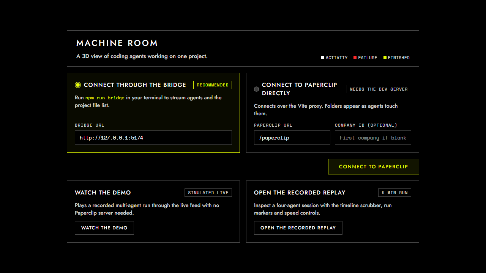
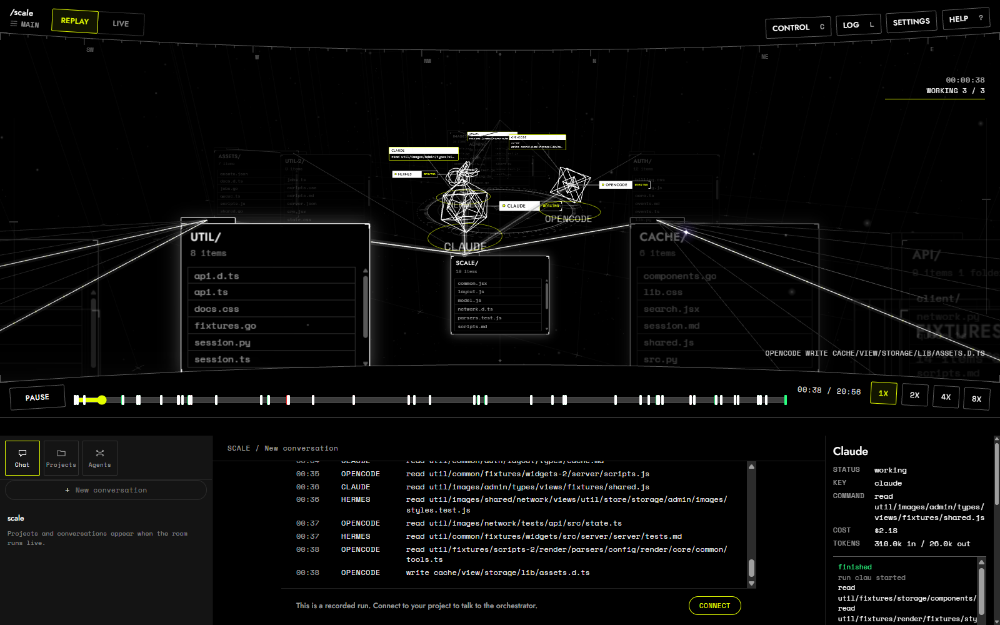

# MachineRoom User Guide

This guide covers how to start, use, configure and control MachineRoom on your projects.

## Table of contents

- [Start it on your project](#start-it-on-your-project)
- [What you see](#what-you-see)
- [The sidebar](#the-sidebar)
- [The transport](#the-transport)
- [The inspector](#the-inspector)
- [Settings](#settings)
- [Ask the orchestrator for work](#ask-the-orchestrator-for-work)
- [Start one lane by hand](#start-one-lane-by-hand)
- [Run a lane from a terminal](#run-a-lane-from-a-terminal)
- [Replay a recorded run](#replay-a-recorded-run)
- [The control drawer](#the-control-drawer)
- [Where the logs and records are](#where-the-logs-and-records-are)
- [Keyboard](#keyboard)
- [Keys and privacy](#keys-and-privacy)
- [What it never does](#what-it-never-does)
- [Five common problems](#five-common-problems)
- [Harnesses](#harnesses)

## Start it on your project

The short way links the `machineroom` command once, then starts the room from any project folder.

```
cd <MachineRoom folder>
npm install
npm run build
npm link
```

```
cd <your project folder>
machineroom
```

`machineroom` runs `up` on the folder you are in. It prints the address and opens the room in your browser.

- `machineroom <folder>` starts the room on another folder.
- `--no-open` leaves the browser closed.
- `--port <n>` picks another port, 5174 by default.
- `--no-sessions` leaves your own Claude Code and OpenCode sessions out.
- `--help` prints the usage text.

After you pull a new MachineRoom version, run `npm run build` in the MachineRoom folder again. Run `npm unlink -g machine-room` to remove the linked command.

The long way runs these commands in the MachineRoom folder:

```
npm install
npm run build
npm run serve -- up --root <your project folder>
```

`up` checks the project folder, git, the built viewer, the runs folder and the lane programs. It prints one line for each check, then serves the room on one port. It prints the address to open, such as `http://127.0.0.1:5174/?live&bridge=http://127.0.0.1:5174`. Open that address in your browser.

Flags for `serve`:

- `--root <folder>` sets the project folder. Quote paths that have spaces.
- `--port <n>` picks another port.
- `--dist <folder>` sets the built viewer folder.
- `--open` opens the browser automatically.
- `--no-open` leaves the browser closed.
- `--lanes` shows runs started by the lane runner and by Dispatch.
- `--sessions` shows your own Claude Code and OpenCode sessions on that folder.
- `--no-sessions` leaves sessions out.

`up` turns on both `--lanes` and `--sessions` automatically. Plain `npm run serve` needs `--lanes` or `--sessions` passed by hand.

`npm run serve -- doctor --root <your project folder>` runs the checks without serving the room.

A first visit with no saved connection opens the connect screen.



The connect screen offers `Take the tour`. The tour opens `/?replay&fixture=scenario-i&tour`, steps through the room parts with a yellow outline, and offers `Connect to my project` on the last step.

Press Ctrl+C in the terminal to stop the room.

## What you see

The room is made for a desktop window at 900 pixels and wider. The page does not scroll. It has a menu row at the top, the lens in the upper frame, the transport bar in the middle, and three columns in the lower half.

Two rails sit on the lens:

- Height on the left edge sets the lens height from 30 to 85 percent of the window, 56 percent by default.
- Zoom on the right edge moves the camera distance between 500 and 8000 units.
- Both rails show at faint opacity at rest and brighten when hovered, dragged, turned with the wheel, or focused with keys.

The 3D room shows these objects:

- The hub: a flat ring in the middle. Each agent parks at its slot in roster order, working or not. The main orchestrator floats above the centre.
- Sectors: when sub orchestrators are set, the ring splits into named arcs. Each sub orchestrator floats above its arc at 0.7 the size of the main orchestrator, joined by a thin white line. Its lanes park inside that arc on a lower ring.
- Folder cards: flat cards on a ring around the hub, facing you. The root card sits directly under the hub and shows the project name. Lines join top-level folders to the root card, and child folders to their parent. Top-level folders arrange on clock hours up to 12. Deeper child folders branch outward in grid rows.
- Folder card depth: folders down to depth 2 are always drawn by default, up to 300 cards. Clicking a folder card head pops it up 140 units and draws its child folders as cards. Clicking it again folds them back. A folder with unexpanded child folders shows up to three folder blocks behind its face. Bulk folders like `node_modules`, `dist` and `build` stay closed until touched.
- Cards list their files as rows, up to 6 by default. Longer lists scroll inside the card.
- Agent colours: each agent has its own colour, and a subagent takes its parent's.
- Tunnels and stars: while an agent works, a grey tunnel runs from the agent to the card that holds the file it touches. Each read or write sends a star in the agent's colour along the tunnel. When it lands, the file row flashes white and a `read NAME` or `write NAME` label rises from the card. Stars also fly from an orchestrator to a lane it starts, from a parent to a subagent, and between agents when they give orders or report. When an agent touches the web, a blue tunnel runs from the agent to the wireframe INTERNET sphere above the hub, and a star flies along it.
- Camera brackets: the card an agent works in shows four corner brackets in that agent's colour, and the file it touches shows small brackets around its name in the same colour.
- Replay speed: stars, labels and flashes follow the replay speed and hold while the replay is paused.
- Colours:
  - White is activity. A read or write flashes the file row white.
  - Yellow is active: the selected folder, the context ring past autocompact and the outlines of the tour.
  - Green is finished work. A run that ends well turns the agent, its chip and its written files green.
  - Red is failure. A failed tool call, test or run flashes red. A failed run turns the agent, its chip and its tunnel red.
  - Blue is the web. A tool call that touches the network lights a blue tunnel to the INTERNET sphere.
- Terminal chips: a chip beside each agent shows its name and status word. Click it or press T to show the log. An agent running shell commands also shows a cyan CONSOLE above its head with its last five log lines. Clicking an address inside it opens the URL in a new tab.
- Camera and follow mode: the overview fits the hub and top-level cards. Follow mode (F) cycles wide, close up, and off. It follows the card an agent touches. Clicking an agent focuses it. Clicking a card body holds the camera 700 units away. Press 0, Escape with no panel open, or double click empty space to return to the park view.
- Failure tray: in a live room, a red failure tray sits at the bottom right of the lens, showing recent failed runs and tool calls. Click a row to inspect that agent. Click Clear to dismiss the tray.

## The sidebar

The sidebar sits in the left column at 900 pixels and wider. Below 900 pixels, click Sessions in the folded menu to open it as an overlay.

Three tabs sit at the top: Chat, Projects and Agents.

- Chat: holds the rounded `+ New conversation` button to start a fresh orchestrator session. It lists conversations for the open project, grouped by Pinned, Starred and Recent. Each row offers Pin, Star, Rename and Delete. Clicking a conversation opens a read-only preview with a Continue button to resume it.
- Projects: holds current and recent projects. In a live room, the top shows the Repository section with the current branch or detached SHA, uncommitted change counts, and a scrollable branch list. The current branch shows in yellow. Each branch shows commits ahead and behind. Switch changes the branch when the checkout is clean. New branch creates a branch from a chosen ref without switching. `Show the tree` opens Source control in the inspector and holds the camera on the git tree. Clicking another project opens the room on that folder.
- Agents: holds `Build a team` and the family tree. `Build a team` sets up 1 to 4 orchestrators with 1 to 3 coders each from active and idle lanes. The family tree lists the orchestrator at the root with children indented. Each row shows label, harness, model, effort, a state dot, and a state word or task. Orchestrators have a Chat button. Lanes have an active switch and a remove button. Checkboxes let you select lanes to create a sub orchestrator over them. Clicking a row opens its editor to change label, harness, model, effort or autocompact rules. A Requests group lists proposals from orchestrators with Approve and Decline.

## The transport

The transport bar sits between the lens and the lower columns at 900 pixels and wider.

- Middle status: shows `ORCHESTRATOR` with its state word: `working`, `waiting for you` or `paused`.
- Context ring: a 22 pixel ring left of the clock shows the orchestrator context token percent. It is white below autocompact, yellow at or past it, and red above 95 percent. Clicking it focuses the chat input.
- Sub orchestrator chips: compact chips after the state word show each sub orchestrator with its name and state dot. Up to four show before `+N`. Clicking a chip opens that sub orchestrator chat tab and focuses the chat input.
- Lane pills: compact pills after the sub chips show lanes that are queued, working or failed in their last run. Each pill shows the lane label, task or brief id, a state dot, runtime minutes, and `N/M` for queue steps. Working lanes come first, failed lanes newest first, up to six before `+N`. Clicking a pill inspects that lane.
- Spend pill: sits just left of the context ring, showing `$X.XX today · $Y.YY mo` from the cost board. Clicking it scrolls the cost board into view in the right column.

## The inspector

The inspector opens in the right column at 900 pixels and wider, replacing the agent dock. Below 900 pixels, it opens as a fixed panel over the dock.

The inspector opens when you click an agent, a folder card, a file row, the INTERNET sphere, the git tree, or a lane pill in the transport.

- Agent: shows label, harness, model, effort, status word (`thinking`, `working` with tool and command, `idle`, `failed`, `done`), current task, context share and tokens for an orchestrator, month cost and tokens in a live room, the last 12 log lines, and recent chat messages with an Open chat button.
- Folder: shows a breadcrumb path, subfolders, and files from the project tree. Clicking an inner folder focuses it.
- File: shows the path, size, last change time, touch history listing every agent read or write with timestamps, and a plain text file preview.
- INTERNET: shows connection state (`Connected` or `No connection`) and which agents are making network calls.
- Git tree: shows Source control. It lists the current branch or detached SHA, uncommitted changes with status letters, and a commit graph with commit dots, subjects, and branch badges. Clicking an uncommitted file selects it.
- Closing: click Close, press Escape, or double click empty space to close the inspector and return the right column to the agent dock and cost board.

## Settings

Click Settings in the top menu to open the panel. At 900 pixels and wider it is a dropdown under the menu. Below 900 pixels it opens in the dock.

- Folder depth: slider from 1 to 3, default 2. Sets how deep folders are automatically drawn as cards.
- Content files: slider from 4 to 20, default 6. Sets how many file rows appear on each folder card before scrolling.
- Screen effects: five effects with switches and strength sliders.
  - Chromatic aberration: radial colour fringe across the lens. Starts off.
  - Vignette: soft darkening at lens edges. Starts on.
  - Grain: fine single-pixel noise. Starts off.
  - Fine dust: 3D dust motes drifting in the void. Starts on. Includes a Pulse switch to make dust breathe.
  - Bloom: glows bright WebGL lines while leaving folder cards unlit. Starts off at 40 percent.
- Sound:
  - Beeps: switch and volume slider from 0 to 100 percent, default 30 percent. Plays a short tone when an agent reads, writes, creates or deletes a file.
  - Dance: switch to make folder cards, agent shapes and rings dance to music beats.
  - Pulse: switch to move agent shape vertices with music frequency bands.
  - Music player: volume slider, playlist select (`All`, `Loose tracks`, or subfolder playlists), and playback controls: previous, play or pause, next, shuffle, loop, open folder, and refresh. Put music files or folders into the MachineRoom music folder.
- Replay:
  - Record time: input from 1 to 240 minutes, default 10. Sets how many minutes of live activity the page keeps for replay.
- Direct API: holds up to 20 OpenAI-compatible endpoints. The quick form takes a provider preset, a base URL, an API key, and `Save key`. The custom form takes a name, provider preset, key slot, and model list. Click `Refresh models` on pickers to reload models.
- Web search: picks the search provider for harness web tools: SearXNG, Tavily, Brave, DuckDuckGo, or Off. Enter the URL for SearXNG, or enter and save an API key for Tavily or Brave.
- MCP tools: lists configured Model Context Protocol servers with transport, command or URL, an on/off switch, and Remove. Add servers with stdio commands and arguments or HTTP URLs. Refresh tools lists available tools. Run tool runs a tool behind a confirm card. Enabled servers are passed to Claude Code and OpenCode lane runs.
- Subagents: sets subagent depth limit. Pick 1 or 2. Unlock opens a confirm card to enable depths 3 and 4. Lock returns the limit to 2.
- Keys: lists saved key slot names. Key values are never displayed. Delete removes a saved key slot behind a confirm card.

## Ask the orchestrator for work

With `--lanes` on, click ORCHESTRATOR or press `/`. Write what you want built, press Send, then Start on the confirm card. Stop asks for confirmation before it stops a turn.

The orchestrator reads your project guide (`AGENTS.md`, `CLAUDE.md` or `docs/agents`) before it plans. It asks short questions, at most three at a time, and waits for your answers. Then it:

- splits the work into tasks that touch different files;
- starts each task as a lane run in its own git worktree at `<project folder>/.worktrees/<lane>`;
- wakes when a run ends, reads its log and record, checks the branch, and runs your project tests and build;
- merges a passing branch into your project current branch with a straight-line history and no merge commit;
- writes a follow-up task when a branch fails;
- reports what landed, what failed and what is next.

It starts at most one run per lane. It never pushes. It ends its turn after it starts the runs, so the runs keep going after the turn ends.

When a session passes 80 percent of its context window, the orchestrator writes a short summary of the work and starts a new session from it. The Autocompact switch in the dock turns this off.

### Sub orchestrators

With the chat open, Attach adds a sub orchestrator. You can also use Add sub orchestrator in the sidebar Agents tab. Give it a name, an id, a harness and model, the lanes it owns, one scope glob per line, and Restricted, which is on by default. A restricted sub is expected to change only the files in its scope. The bridge warns its parent when a lane branch goes outside it.

Each sub orchestrator gets its own ring sector and its own tab in the chat. Detach or Remove stops it behind a confirm card and returns its lanes to the main orchestrator. Lanes in no sub stay with the main orchestrator.

## Start one lane by hand

A lane is one agent on one harness. Press C or click CONTROL, then open Dispatch. The `Run on this project` section appears when the room runs with `--lanes`.

- Pick a lane, such as OpenCode, Claude Code or a Direct API lane. An AGY lane shows here only when you added it yourself in the sidebar's Agents tab.
- Write one task in the box.
- Press Run, then Confirm. The confirm card notes that the run spends money.
- Own worktree is on by default: the lane works in `<project folder>/.worktrees/<lane>` inside your project, on its own queue branch. Several lanes can work at once and your project folder is never touched. Each task is committed there when your project tests pass.
- With Own worktree off, one task runs in your project folder itself. The runner makes no branch, writes no recording, and does not run your tests.
- For several tasks, put a line with only `---` between them. The button reads `Run N tasks in order`. A queue needs a clean git folder: commit or stash first.
- To give several tasks to different lanes, turn on `One lane per task`. The button reads `Run N tasks on N lanes`. The confirm card lists each task with the idle lane it goes to, and each run starts in its own worktree. The button refuses when there are fewer idle lanes than tasks.
- A queue makes the branch `machineroom/queue-<lane>-<stamp>`. It runs your project tests after each task, using `npm test` when `package.json` has a test script. It commits each task that passes and stops at the first failed task or test. It never touches your current branch and never pushes. It leaves the folder on the queue branch. `git switch -` goes back. With Own worktree on, the worktree stays on the queue branch and your project folder stays where it was.

The Runs list in Dispatch shows running and recent runs with their last lines.

## Run a lane from a terminal

To start a lane on a folder without Dispatch, name the folder with `--project` and give it a task or a UTF-8 file that holds it:

```
npm run run-lane -- opencode --project <folder> --task "Fix the failing test."
npm run run-lane -- opencode --project <folder> --task-file task.md
```

Add `--dry-run` to print the program, its arguments and the folder, or the worktree and queue branch when `--worktree` is on, and start nothing.

The runner refuses the MachineRoom checkout, a lane worktree, the user profile folder itself, the OS temp folder, the runs folder and a git folder with uncommitted changes. Pass `--allow-dirty` to allow a dirty folder. Without `--worktree` it runs the harness in that folder, makes no branch, reads no brief and writes no recording. The room shows the run live, with its reads and writes on that folder cards.

Add `--worktree` to run in a git worktree of the project instead of the project itself. The runner puts the worktree inside the project at `<project>/.worktrees/<lane>` and adds `/.worktrees/` to the project `.git/info/exclude`, so git, the project files and the room file tree leave it out. Nothing in the project tracked files changes. It makes the worktree from the project HEAD when missing, and reuses it when clean. It refuses a worktree with uncommitted changes and names its path. When the project has `node_modules`, the worktree gets a junction on Windows or a symlink elsewhere. A task with `--worktree` runs as a queue of one. It makes the branch `machineroom/queue-<lane>-<stamp>` in the worktree, runs project tests and commits the task when they pass. A queue with `--worktree` makes its branch in the worktree too. The run record names the worktree as the project, so a room started on the project still shows the run.

To run a queue of tasks on that folder, write them in a plain text file with a line that holds only `---` between them, then:

```
npm run run-lane -- opencode --project <folder> --queue queue.txt --test "npm test"
```

A queue needs a clean git folder, so keep the queue file outside it or commit it first. Before the first task the runner makes the branch `machineroom/queue-<lane>-<stamp>` from the folder HEAD. Each task runs as its own run, then the test command runs. A task that ends well and passes tests is committed on that branch with its first line as the subject. A task with no change is noted and the queue goes on. The first failed task or failed test stops the queue and leaves that task changes uncommitted for you to inspect. `--test` defaults to `npm test` when `package.json` has a test script, and to none otherwise. `--minutes` limits each task. The queue never pushes and never touches the main branch. It leaves the folder on the queue branch and prints the branch and one line per task. Without `--worktree`, `git switch -` goes back. With `--worktree`, the worktree stays on the queue branch and your project folder stays where it was.

With `--sessions`, the room follows your own Claude Code and OpenCode sessions on that folder too. Start it with `npm run serve -- up --sessions --root <folder>`. It reads the session files Claude Code keeps in `.claude/projects` under your profile for that folder. It keeps only lines whose `cwd` is inside the folder. It shows each prompt as a run and each tool call on the room cards, and follows subagents through their own files. A run that `run-lane` starts on the same folder is skipped to prevent duplicate runs. OpenCode sessions come from OpenCode database (`.local/share/opencode/opencode.db` under your profile), opened read-only. The bridge reads only its two session tables, never account or key tables. Only tool calls and their results reach the room, never prompts or replies.

## Replay a recorded run

- `/?replay` plays the frames this page recorded while it was live. Before the first conversation it says `Nothing recorded yet. Replay starts with the first conversation.` It needs no lane and no project.
- `/?replay&fixture=scenario-i` plays the demo ladder: two sub orchestrators and their lanes work, so sectors and chat tabs have live data.
- A lane run on a brief writes a recording under `public/recordings/` in the MachineRoom folder and prints `room: /?recording=<name>`. Run `npm run build` again so the built room serves it, then open that link on the room address.
- A run on a project and a queue write no recording. They are live only.
- `?replay&scale=40000` plays a seeded room of 40000 files in a tenth as many folders. You can set scale up to 500000 files. `&fps` adds a frame time line. `?live&simulate` plays the recording through the live path with no lane and a `Demo` badge.



## The control drawer

Press C or click CONTROL at the top right to open the drawer. It has five tabs: Dispatch, Tasks, Meters, Team and Reviews.

- Dispatch: pick an open brief to see its prompt, or run tasks on your project when `--lanes` is on. The Runs list shows running and recent lane runs with their status and output.
- Tasks: open and finished tasks from lane runs. A task with an active run shows `running AGENT` or `queued AGENT`. Click a task to read its thread. Writes are refused.
- Meters: this month spend per lane from run records, with token counts and a read-only month total. Budgets are not set here.
- Team: the room's lanes, read only. To turn lanes on or off, use the sidebar Agents tab.
- Reviews: shows each lane branch, commits ahead, changed files and last run. Click a row to see its diff. Merge opens a confirm card with a one-line message and merges the inspected head into the current branch.

## Where the logs and records are

Every lane run writes its log to `<runs>`, which is `%TEMP%\machineroom-runs` on Windows, or the system temp folder elsewhere. `MACHINEROOM_RUNS` names another runs folder.

- `<lane>-<briefs>-<stamp>.log` for a run on briefs.
- `<lane>-project-<stamp>.log` for one task on a project without `--worktree`.
- `<lane>-queue-<stamp>-<number>.log` for a task in a queue, and for one task with `--worktree`.
- `<log name>.meta.json` beside a run on a project, with the lane, project folder, session id and base commit.
- `runs.jsonl` has one record for each run: lane, model, start time, minutes, exit code, cost, tokens, log and branch.
- `outcomes.jsonl` holds the outcomes recorded with `npm run outcome`.
- The orchestrator chat and session live in `orchestrator-<hash>.json`. Each sub orchestrator has its own chat file beside it, and each turn writes a `...-chat-<stamp>.log` log file.

The runner prints `log:` and `record:` at the end of each run.

## Keyboard

- `Space` play or pause replay
- `0` return to the overview or park view
- `Escape` return to the park view when no panel is open; close an open panel or dialog
- `1` to `9` focus agent 1 to 9
- `F` follow the card an agent is touching: wide, close up, off
- `T` show or hide the log of the selected agent, or of every agent
- `Left` and `Right` arrows seek backward or forward 5 seconds
- `[` and `]` decrease or increase replay speed
- `/` open the orchestrator chat, or the assistant terminal when the room has no orchestrator
- `L` toggle the event log
- `C` toggle the control drawer
- `?` toggle keyboard help

## Keys and privacy

MachineRoom prints no key and puts none in the repository or `lanes.json`. A Direct API key goes in Settings, Direct API: choose a provider, paste the key, then press `Save key`. Keys are saved in `<runs>/keys.json` outside the repository, with mode 0o600. The bridge needs no key to run: the assistant route runs OpenCode, which uses the login on this computer, and only the optional decision route reads `OPENROUTER_API_KEY` from the environment. The assistant refuses text that looks like a key. The bridge masks key-shaped text in the log chunks, messages and errors it sends, including a key split across two or more chunks. A held chunk delays frames by at most 1 second.

A lane started with `npm run run-lane` sees only a short allow-list of the shell names: `PATH`, `Path`, `PATHEXT`, `SystemRoot`, `WINDIR`, `COMSPEC`, `TEMP`, `TMP`, `USERPROFILE`, `HOMEDRIVE`, `HOMEPATH`, `APPDATA`, `LOCALAPPDATA`, `PROGRAMFILES`, `PROGRAMFILES(X86)`, `PROGRAMDATA`, `NUMBER_OF_PROCESSORS`, `OS`, `PROCESSOR_ARCHITECTURE`, `LANG`, `LC_ALL`, `TERM`, `HOME` and `SHELL`, its own `PWD`, and `MACHINEROOM_RUNS` and `MACHINEROOM_LANES_FILE` when the runner sets them. No key reaches a lane except the one its harness needs. The Direct API harness gets `MACHINEROOM_API_KEY` or `OPENROUTER_API_KEY`, or the key of its saved endpoint, and `MACHINEROOM_API_URL` for its base address. Hermes gets `OPENROUTER_API_KEY`; OpenCode and Claude Code use the login on this computer. The runner also writes the run log through the same `[key]` mask, so a key an agent prints is masked on disk.

## What it never does

- It never pushes to a remote repository.
- The Reviews panel merges a lane only after its confirm card. The bridge also refuses a merge without an explicit confirm and the lane exact head.
- The room starts a lane run from a button only after a confirm card that says it spends money. The orchestrator starts the runs you asked it for after you confirm your first message.
- A run on a project refuses the MachineRoom checkout, the lane worktrees in the room's lane list, the user profile folder itself, the OS temp folder and the runs folder.

## Five common problems

### A lane program is not found

The doctor prints `FAIL The OpenCode lane program was not found: <path>.` or the same for another lane. The room still opens, but that lane cannot start.

Install the program, sign in, and check that it starts in the same shell (`opencode --version`, `claude --version`). If it is installed somewhere else, put its full path in `cli.bin` for that lane in the room's `lanes.json` (`config/lanes.json`, or the folder `MACHINEROOM_LANES_DIR` names), then run the doctor again.

### The doctor prints FAIL lines

Run the doctor on the folder you watch:

```
npm run serve -- doctor --root <your project folder>
```

It checks that the project folder exists, git is on the PATH, the built viewer exists, the runs folder can be written, and every lane program is found. It prints `ok` or `FAIL` for each line and exits 1 on a failure. Fix the failed line and run it again. `up` prints the same lines and opens the room anyway, with `Some checks failed. The room opens anyway.`

A line that names an environment variable that is not set means the lane `cli.bin` uses `%NAME%`. Set that variable, or use a full path.

### A dirty project is refused

The run is refused with `The project folder <folder> has uncommitted changes. Commit or discard them, or pass --allow-dirty.` Commit or stash your work, then start the run again. In Dispatch, a single task can start with `Allow uncommitted changes` turned on. A queue always needs a clean folder, so that switch stays off for several tasks.

### A port is taken

The room stops with `machine-room could not start:` and a message that the address is already in use. Another room or program has the port, 5174 by default. Pick another one:

```
npm run serve -- up --root <your project folder> --port 5175
```

Or set `PORT`. The room prints the new address. `--port 0` picks a free port.

If another room is already running on the same project, the message names that room instead, and a new port does not help. Open the address the first room printed, or stop that room.

### No agents are shown

When `--lanes` is on, the room lists one agent for each active lane in the room's `lanes.json` that is not retired and has a `cli` block, and for each lane you made. If the list is empty:

- You started `npm run serve` without `--lanes` or without `up`. Start with `up`, or add `--lanes`.
- Every lane is turned off. Open Agents in the sidebar and turn one on.
- The page is in replay mode. Open the `/?live&bridge=...` address the command printed, or press Live.
- The bridge is not answering. The waiting card says the feed is unreachable. Start the room again and open the printed address.

## Harnesses

| Harness | State | What the room reads |
| --- | --- | --- |
| OpenCode | Supported: a lane you make | `tool_use` lines, with the tool, its file or command and its result |
| Claude Code | The orchestrator, and a lane you make | stream-json `tool_use` and `tool_result` lines, and a `Task` or `Agent` child while it works |
| Direct API | Supported: a lane you make on the `machineroom` harness with a saved endpoint | Claude Code stream-json lines from `scripts/mr-agent.mjs` over an OpenAI-compatible endpoint |
| Hermes | Supported, retired | plain `read` and `delegate` lines |
| AGY | Supported: a lane you make | `step_update` lines, and `invoke_subagent` for a subagent |
| ACP | Supported: no lane yet | `tool_call` updates, with each kind and location mapped to a touch |
| Codex | Supported: no lane yet | `exec --json` item lines |
| GitHub Copilot | Supported: no lane yet | `-p --output-format json` lines, or plain tool lines |

A new room's `config/lanes.json` holds only the orchestrator, and the lanes you make in Settings are kept in `<runs>/agents.json`. A lane marked `"retired": true` in a lane list does not start. A Direct API lane names a saved endpoint in its `cli.endpoint` and runs on the `machineroom` harness. Add its key and endpoint in Settings, Direct API, then pick its model in the family tree. Any Agent Client Protocol agent can be added as a lane with its own `cli.bin` and args; it runs through `scripts/acp-run.mjs`.
